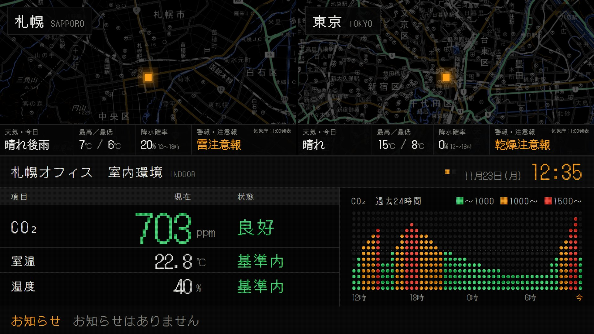
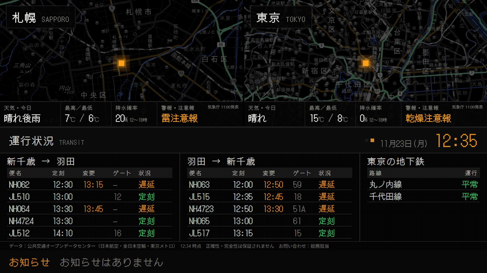

# raspberrypi-env-station

室内に置いた Raspberry Pi 4 Model B（8GB）で、CO2・温度・湿度を定期的に計測して SQLite に記録する。
同じ Pi で、気象庁の防災情報 XML と、みちびき（QZSS）の L1S 信号で配信される災危通報を受け取る。
結果は、帰宅に使う在来線と出張で使う新幹線の運行状況、よく使う便の遅延・欠航とあわせて、室内の大型モニターに地図とグラフで常時表示する（ダッシュボードは地図と CO2 まで。警報の一覧・XML 取得・交通情報は未実装）。

**設計図**: https://shiwaku.github.io/raspberrypi-env-station/design.html （元ファイルは [docs/design.html](docs/design.html)。`main` にマージすると GitHub Pages に反映される）

| 役割 | 機材 | 接続 | 状態 |
|---|---|---|---|
| CO2・温度・湿度 | 秋月 AE-SCD40-BO（Sensirion SCD40） | I2C 0x62 | 購入済み |
| 災危通報の受信 | SparkFun Qwiic MAX-M10S（18037）+ Quectel YG0035AA アンテナ（ケーブル 3m） | I2C 0x42（Qwiic） | 注文済み |
| 気象情報（警報・注意報・地震） | 気象庁 防災情報XML の Atom フィード | 共用 Wi-Fi → インターネット | 未実装 |
| 鉄道の運行状況（帰宅に使う在来線、出張で使う新幹線） | ODPT など（入手先を調査中、#12） | 共用 Wi-Fi → インターネット | 未実装 |
| 飛行機の遅延・欠航（よく使う行き先の出発便） | ODPT など（入手先を調査中、#13） | 共用 Wi-Fi → インターネット | 未実装 |
| 設置場所 | `config.toml` の `[station]` に緯度経度を書く | — | — |

設置場所は動かないので GPS では測らない。

## 配線

はんだ付けはしない。Pi の GPIO には SCD40 の付属ケーブル（150mm、Pi 側がメスのソケット）を 1 本だけ差し、その先に Qwiic で機材を数珠つなぎにする。電源を切ってから配線する。

```
Pi GPIO 1・3・5・6 番 ─(SCD40 付属ケーブル 150mm)─ MAX-M10S ─(Qwiic ケーブル 100mm)─ SCD40（CN1）
```

| ケーブルの線 | Raspberry Pi（物理ピン） |
|---|---|
| 赤 3.3V | 3.3V（1 番） |
| 青 SDA | GPIO2 / SDA（3 番） |
| 黄 SCL | GPIO3 / SCL（5 番） |
| 黒 GND | GND（6 番） |

MAX-M10S（I2C 0x42）と SCD40（0x62）は同じ I2C の線を共有する。アドレスが違うので混ざらない。アンテナは MAX-M10S の SMA 端子に差し、窓際に置く。アンテナのケーブルは 3m なので、窓際から Pi まで 3m 以内に置く。

- GPIO の 40 本のピンは、基板の長い辺の端に 2 列で並ぶ。1 番は USB・LAN 端子から遠い端で、基板の内側の列にある（裏から見るとハンダが四角）。内側の列が奇数、端の列が偶数
- 端の列の 1 番側の 2 本（2 番・4 番）は 5V。センサーの電源をここに差すと壊れる
- 線の色は Qwiic の標準（黒 GND・赤 3.3V・青 SDA・黄 SCL）。SCD40 の基板の G・+・D・C の印字と見比べて確かめる
- 向きのわかる図は[設計図の配線](https://shiwaku.github.io/raspberrypi-env-station/design.html)にある

## Raspberry Pi の準備

### Tera Term の鍵を作る（PC で作業）

Pi には PC の Tera Term から SSH で入る。パスワードでは入れないようにし、鍵の認証だけを許す。

1. Tera Term を起動し、「設定」→「SSH 鍵生成」を開く。
2. 鍵の種類に **ED25519** を選んで「生成」を押す。
3. 鍵のパスフレーズを入れ、「公開鍵の保存」で `id_ed25519.pub` を、「秘密鍵の保存」で `id_ed25519` を保存する。秘密鍵は PC から外に出さない。

### OS を microSD に書き込む（PC で作業）

1. [Raspberry Pi Imager](https://www.raspberrypi.com/software/) で「Raspberry Pi 4」「Raspberry Pi OS (64-bit)」（デスクトップ付き）を選ぶ。モニターにダッシュボードを映すので Lite ではなくデスクトップ版にする。
2. 設定の編集で、ホスト名・ユーザー名とパスワード・Wi-Fi を入れる。
3. 同じ画面のサービス（リモートアクセス）の欄で SSH を有効にし、**公開鍵認証のみを許可**を選んで、`id_ed25519.pub` の中身（1 行）を貼る。パスワード認証は有効にしない。
4. 書き込んだ microSD を Pi に挿し、モニター・USB キーボード・マウスをつないで電源を入れる。最初の起動とアドレスの確認は Pi の画面で行う。

### Tera Term で Pi に入る

1. Pi の画面でターミナルを開き、`hostname -I` で Pi の IP アドレスを調べる。
2. PC の Tera Term で「ファイル」→「新しい接続」を開き、ホストにその IP アドレス、サービスに SSH（ポート 22）を入れて接続する。
3. 認証の画面でユーザー名を入れ、「RSA/DSA/ECDSA/ED25519 鍵を使う」を選んで `id_ed25519` を指定し、鍵のパスフレーズを入れる。
4. 入れたら、パスワードでは入れない設定になっているか確かめる（`passwordauthentication no` と出れば OK）。

```sh
sudo sshd -T | grep -i passwordauthentication
```

- 共用 Wi-Fi が端末どうしの通信を遮断している（クライアント分離）と、PC から Pi に届かない。そのときは運営者に相談するか、PC と Pi を LAN ケーブルで直接つなぐ
- IP アドレスは再起動などで変わることがある。つながらなくなったら Pi の画面で `hostname -I` を見直す

### 先に会社や自宅で動かしてみる

コワーキングに置く前に、会社や自宅の Wi-Fi で計測と SSH を確かめてよい。Imager の Wi-Fi 欄には、最初に使う場所の Wi-Fi を入れる。

場所を移すときは、移す前に次の場所の Wi-Fi を Pi に登録しておく。Pi の画面右上の Wi-Fi アイコンから選んでもよい。登録した Wi-Fi は、見つかれば自動でつながる。

```sh
sudo nmcli dev wifi connect "<SSID>" --ask     # パスワードを聞かれる
nmcli connection show                          # 登録済みの Wi-Fi の一覧
```

IP アドレスは場所ごとに変わるので、移したら Pi の画面で `hostname -I` を見て、Tera Term の接続先を変える。

### コワーキングの共用 Wi-Fi で使う

設置場所はコワーキングスペースの一室で、Wi-Fi は施設の共用回線を使う。つなぐ前に運営者に次を確かめておく。

- 端末の登録（MAC アドレスの申請）が必要か。ブラウザでログインする方式（キャプティブポータル）だと、つなぐときに Pi の画面でログインし直す必要がある
- 認証方式。WPA2/WPA3-Personal なら Imager の設定欄で足りる。WPA2-Enterprise（ID とパスワードで入る方式）なら、別に設定が要る
- 常時接続する機器を置いてよいか
- 端末どうしの通信が遮断されていないか（クライアント分離）。遮断されていると PC の Tera Term から Pi に入れない

共用回線にはほかの入居者の機器も載るので、Pi が受け付ける接続は SSH だけにし、それも鍵がないと入れないようにする。

- SSH は鍵の認証だけを許す（パスワード認証は無効）。秘密鍵のある PC の Tera Term からだけ入れる
- ダッシュボードの Web サーバーは `127.0.0.1` だけで待ち受け、Pi 自身の画面からだけ開く
- Wi-Fi は外向きの通信（気象庁 XML・ナウキャスト・背景地図・交通情報の取得、OS の更新）だけに使う
- 背景地図は国土地理院の[地理院タイル](https://maps.gsi.go.jp/development/ichiran.html)の淡色地図・標準地図・シームレス空中写真を切り替えて使う（画像タイル、API キー不要、既定は淡色地図）。Pi には置かず、Chromium が直接読む。地図に「地理院タイル」の出典を表示する

### 大型モニターにつなぐ

Pi 4 の映像出力は micro-HDMI。**micro-HDMI to HDMI ケーブル**でモニターの HDMI 入力につなぐ。電源（USB-C）の隣の端子（HDMI0）を使う。

- 画面は 60 インチ以上を想定。4K の画面でも、Pi からは 1920×1080 で出してテレビ側で拡大させる。4K で出すと地図の描画が重くなり、文字も小さくなる
- 長さは 5m 程度までなら普通のケーブルで足りる。それ以上はアクティブケーブルを使う
- 画面が自動で消えないよう、`sudo raspi-config` の Display Options → Screen Blanking を無効にする
- テレビを使う場合は次も確認する
  - 無操作や無信号で電源が切れる設定（無操作電源オフ・オートパワーオフ）を切る
  - 画面の端が欠けるときは、テレビの画面サイズ設定を「全画素表示」「ジャストスキャン」などにする
  - 有機 EL は同じ画面を出し続けると焼き付くことがある。液晶ならまず問題ない。有機 EL なら夜間は画面を消す
- ダッシュボードは 3〜5m 離れて読める文字の大きさで作る（CO2 の現在値は大きく、細かい表は載せない）
- ダッシュボードは起動時に Chromium の全画面表示（キオスク表示）で開く（「起動時に自動で動かす」を参照）

### I2C を有効にする（Pi で作業）

```sh
# Interface Options → I2C → Yes
sudo raspi-config
sudo reboot

# SCD40 が見えるか確認（62 が表示されれば OK。MAX-M10S をつないだ後は 42 も出る）
sudo apt install -y i2c-tools
i2cdetect -y 1

# uv を入れる
curl -LsSf https://astral.sh/uv/install.sh | sh
```

## 使い方（CO2・温度・湿度）

```sh
uv sync --extra pi
cp config.example.toml config.toml   # [station] の緯度経度を設置場所に合わせる

uv run env-station --once            # 1 回だけ計測して表示
uv run env-station                   # interval_s ごとに計測し続ける（Ctrl+C で終了）
```

実機がない PC では `uv sync` してから `uv run env-station --fake` でダミー値を記録できる。

## ダッシュボード（大型モニター）





画像は 2026-11-23 12:35 の表示。気象と運行状況は実際のデータ、室内環境はダミーデータ。

画面は SvelteKit と MapLibre GL JS（TypeScript）で作り、`web/` で静的ファイルにビルドする。
Python の `env-dashboard` がそのファイルと計測値の API（`/api/config`・`/api/latest`・`/api/series`）を `127.0.0.1:8080` で配信する。
見た目は駅や空港の発車標のような、黒地に LED の色で光る表示板にしている。文字は日本語のドット書体 [DotGothic16](https://fonts.google.com/specimen/DotGothic16)（OFL、`@fontsource/dotgothic16`）で、ビルドに同梱するのでネットがなくても出る。
画面は 1920×1080 で組み、ウィンドウに合わせて拡大・縮小する。3〜5m 離れても読める大きさにしている。

- 上半分: 拠点の地図を 2 つまで横に並べる（札幌・東京など）。`config.toml` の `[[dashboard.offices]]` に名前・緯度経度・ズームを書く。書かなければ `[station]` を 1 つだけ出す。地図は地理院タイルの淡色地図を反転させた暗い地図で、拠点に橙の印を出す
- 下半分: 設置場所（`[station]` の名前）の室内環境。CO₂・室温・湿度の現在値と状態、CO₂ の直近 24 時間を LED の点の棒グラフ（30 分ごとの平均）で出す
  - 状態は建築物衛生法の基準で判定する。CO₂ は 1,000ppm 未満を「良好」（緑）、1,000ppm 以上を「要換気」（橙）、1,500ppm 以上を「至急換気」（赤）。室温は 18〜28℃、湿度は 40〜70% の中なら「基準内」（緑）、外なら「基準外」（橙）
  - 計測値が 5 分以上届かないときは「受信なし」にする
- 下半分の表示板は、運行状況の設定があれば 20 秒ごとに「室内環境」と「運行状況」のページを切り替える（右上の印でどちらのページかわかる）
- 一番下: お知らせを右から左へ流す（換気の呼びかけ、基準外、計測値が届かない、欠航、地下鉄の遅延・運転見合わせなど）
- 地図の下端: 拠点ごとの天気予報と警報・注意報（下の「気象」）
- ライブ映像は未実装。中身ができるまで画面には出さない

### 気象（拠点ごとの天気予報と警報・注意報）

[気象庁防災情報 XML](https://xml.kishou.go.jp/) から取る。`env-dashboard` が気象庁のフィードを 2 分ごとに見て、拠点の新しい電文が出たときだけ取る（気象庁は同じファイルを取り直さない実装を求めている）。起動時は長期フィードから最新の電文を探す。

- 天気・降水確率・最高／最低気温: 府県天気予報（VPFD51）。天気は今日（夕方以降は今夜）、降水確率は今の 6 時間、最高気温はこれからの「日中の最高」、最低気温はこれからの「朝の最低」
- 警報・注意報: 気象警報・注意報（H27 形式、VPWW54）の市町村ごとの欄。特別警報・警報は赤、注意報は橙、なければ「発表なし」。警報と特別警報はお知らせにも流す
- 今の気温は電文にないので出さない
- 帯の右上に「気象庁 HH:MM 発表」と出典を出す

拠点ごとに `config.toml` の `[dashboard.offices.weather]` を書く（書かなければ帯を出さない）。

| 項目 | 内容 | 札幌の例 | 東京（千代田区）の例 |
|---|---|---|---|
| `office` | 府県予報区（電文のファイル名の末尾 6 桁） | `016000`（石狩・空知・後志地方） | `130000`（東京都） |
| `area` | 天気・降水確率の区域（一次細分区域） | `016010`（石狩地方） | `130010`（東京地方） |
| `station` | 気温の地点 | `14163`（札幌） | `44132`（東京） |
| `city` | 警報・注意報の市町村 | `0110000`（札幌市） | `1310100`（千代田区） |

ほかの地域のコードは、その府県予報区の府県天気予報と気象警報・注意報の電文（[フィード](https://xml.kishou.go.jp/xmlpull.html)から開ける）の `Area`・`Station` の `Code` で調べる。

### 運行状況（飛行機・東京の地下鉄）

[公共交通オープンデータセンター（ODPT）](https://developer.odpt.org/)から取る。`env-dashboard` が 5 分ごとに取り直し、画面からの問い合わせには手元の値を返す。

- 飛行機: `flight_routes` の路線の JAL・ANA の出発便を、定刻の早い順に 5 便ずつ出す（便名・定刻・変更時刻・ゲート・状況）。出発済みの便は出さない。AIRDO の便は ANA の共同運航便（NH4700 番台など）として出る。スカイマークは ODPT にデータがないので出ない
- 東京の地下鉄: `railways` の路線の運行情報（平常・遅延・運転見合わせ）
- 札幌の鉄道（JR 北海道・札幌市営地下鉄）と JR（新幹線を含む）は、公式の機械可読データがないので出せない（[#12](https://github.com/shiwaku/raspberrypi-env-station/issues/12)）

準備:

1. [ODPT の開発者サイト](https://developer.odpt.org/)で開発者登録をして、アクセストークンを発行する。`api.odpt.org` 用のトークンを使う（公共交通オープンデータチャレンジのトークンは `api-challenge.odpt.org` 用で使えない）
2. `config.toml` の `[transit]` に `odpt_token`・`flight_routes`・`railways`・`contact` を書く（`config.example.toml` を参照）。`config.toml` はリポジトリに入らない
3. `systemctl --user restart env-dashboard`

路線の ID:

| 事業者 | ID |
|---|---|
| 東京メトロ | `odpt.Railway:TokyoMetro.` に `Ginza`（銀座線）・`Marunouchi`（丸ノ内線）・`MarunouchiBranch`（丸ノ内線支線）・`Hibiya`（日比谷線）・`Tozai`（東西線）・`Chiyoda`（千代田線）・`Yurakucho`（有楽町線）・`Hanzomon`（半蔵門線）・`Namboku`（南北線）・`Fukutoshin`（副都心線） |
| 都営 | `odpt.Railway:Toei.` に `Asakusa`（浅草線）・`Mita`（三田線）・`Shinjuku`（新宿線）・`Oedo`（大江戸線）・`Arakawa`（都電荒川線）・`NipporiToneri`（日暮里・舎人ライナー） |

ODPT の規約（公共交通オープンデータ基本ライセンス）に合わせて、運行状況のページの下に、出典（公共交通オープンデータセンターと各事業者）、データの時刻、正確性・完全性を保証しないこと、問い合わせ先を出している。取ったデータは Pi の中だけで使い、ほかへ配り直さない。

```sh
# Node.js は pnpm が web/package.json の devEngines に従って自動で用意する（Node 26）
curl -fsSL https://get.pnpm.io/install.sh | sh -   # pnpm が無ければ入れる
sudo apt install -y fonts-noto-cjk                 # 日本語フォント（入っていなければ）

cd web
pnpm install
pnpm build      # web/build に出力
cd ..

uv run env-dashboard   # http://127.0.0.1:8080/ を Pi の Chromium で開く
```

画面だけを直すときは、`uv run env-dashboard` を動かしたまま `cd web && pnpm dev` で開発用サーバーを起動する（API は 8080 に中継される）。起動時に全画面で開く設定は「起動時に自動で動かす」を参照。

## 災危通報の受信

デコードと表示は [qzss_dcr](https://github.com/fractional-n/qzss_dcr)（MIT）に任せる。このリポジトリには含めず、別に clone して動かす。

MAX-M10S は I2C でつなぐので、I2C（0x42）から読んだデータを `localhost:2101` の TCP に流す中継プログラムを Pi で動かし、qzss_dcr は TCP 入力で受け取る。qzss_dcr が送る L1S の設定も、同じ中継を通って MAX-M10S に書き込まれる。中継プログラムは `gnss-relay` で、バイト列を加工せずに両方向へ流す。

```sh
# 1. 中継プログラム（127.0.0.1:2101 で待ち受ける）
uv run gnss-relay          # 先に uv sync --extra pi をしておく

# 2. 別の端末で qzss_dcr（L1S を有効にする設定も送る）。ホームに clone する（自動起動の設定がこの場所を前提にしている）
cd ~
git clone https://github.com/fractional-n/qzss_dcr.git
cd qzss_dcr
python3 -m venv .venv && .venv/bin/pip install 'azarashi>=0.17.1,<0.18' pyserial
.venv/bin/python qzss_dcr.py --tcp localhost:2101 --configure-m10 --ubx-port I2C
```

- `gnss-relay` は受信機を 0.05 秒ごとに読む。受信機は 1.5 秒読まれないと出力を止めるので、qzss_dcr がつながっていなくても読み続ける
- I2C の読み書きに失敗しても（配線の抜き差しなど）止まらず、qzss_dcr とつないだままやり直す
- qzss_dcr の作者が用意した記録データ（`samples/demo_l1s.ubx`・`demo_dcx.ubx`）を偽の受信機から流し、中継を通して MT43・MT44 が日本語になること、`--configure-m10` の設定がそのまま受信機側へ届くことを確かめた。実機ではまだ動かしていない

`--configure-m10` の設定は MAX-M10S の RAM にだけ書かれ、電源を切ると消える。起動のたびに付けるか、`--persist` で BBR（バックアップ用のメモリ）にも書く。自動起動の設定（`deploy/systemd/qzss-dcr.service`）では、起動のたびに付けている。

アンテナは南向きの窓際に置く。静止軌道の QZS-3 が南の空にいるため。みちびきが見えていれば、災危通報の枠（MT43 と MT44）はそれぞれ 4 秒ごとに届く。平常時は中身のない通報なので、画面には何も出ない。配信される情報と頻度、ネット配信との違い、法的な位置づけ、L1S 信号の仕様、訓練配信の日程は [みちびき災危通報の整理](https://shiwaku.github.io/raspberrypi-env-station/qzss-dcr.html)（元ファイルは [docs/qzss-dcr.html](docs/qzss-dcr.html)）にまとめた。

## 起動時に自動で動かす

停電や再起動のあとも、人の操作なしで計測・ダッシュボード・受信が再開するようにする。上の手順で `uv sync --extra pi`・`config.toml`・`web/build` を用意してから実行する。

```sh
cd ~/raspberrypi-env-station
deploy/install.sh               # 計測・ダッシュボード・キオスク表示
deploy/install.sh --with-gnss   # MAX-M10S をつなぎ、~/qzss_dcr を用意してから。中継と災危通報の受信も足す
sudo reboot
```

- `deploy/systemd/` のユニットを systemd のユーザーサービスとして入れる。ログインしていなくても起動時に動くよう、linger を有効にする（初回だけ sudo を使う）
  - `env-station`：計測
  - `env-dashboard`：ダッシュボードの配信（127.0.0.1:8080）
  - `gnss-relay`：MAX-M10S の I2C と TCP の中継
  - `qzss-dcr`：災危通報の受信。通報は `data/qzss_dcr/日付.jsonl` に追記する
- どれも止まったら自動で起動し直す
- デスクトップにログインすると、`deploy/kiosk/start-kiosk.sh` が env-dashboard の起動を待ってから Chromium を全画面で開く（`~/.config/autostart/env-kiosk.desktop` から起動）。抜けるときは Alt+F4
- リポジトリは `~/raspberrypi-env-station` に置く。ユニットファイルがこの場所を前提にしている
- 手で `uv run env-station` などを動かしているときは止めてから実行する。I2C やポートを取り合う
- ユニットファイルを直したら、もう一度 `deploy/install.sh` を実行すると反映される
- 画面を作り直して `web/build` を再ビルドしたときは、サービスの再起動はいらない。Chromium で F5 を押して読み直す

```sh
systemctl --user status env-station env-dashboard   # 動いているか
journalctl --user -u env-station -f                 # ログ
systemctl --user restart env-station env-dashboard  # config.toml を変えたあと
```

## データ

`data/readings.sqlite` に保存する。時刻は UTC。

`readings` テーブル（1 行 = 1 時刻 × 1 センサー × 1 指標）:

| ts | sensor | metric | value |
|---|---|---|---|
| 2026-11-07T10:00:00+00:00 | scd4x | co2_ppm | 612 |
| 2026-11-07T10:00:00+00:00 | scd4x | temperature_c | 22.4 |

`station` テーブル（1 行だけ）: 起動時に `config.toml` の `[station]` の内容を書き込む。

```sh
sqlite3 data/readings.sqlite \
  "SELECT ts, value FROM readings WHERE metric = 'co2_ppm' ORDER BY ts DESC LIMIT 10"
```

## 注意

- SCD40 の CO2 保証範囲は 400〜2000 ppm。電源投入直後の数分は値が安定しない。
- SCD40 は自動補正（ASC）が既定で有効。週に 1 回は外気程度（約 400 ppm）まで下がる前提で補正される。夜間や週末に無人になる部屋なら条件を満たしやすい。
- SCD40 の温度は自己発熱や Pi の熱で高めに出る。センサーは Pi から離して置く。
- 災危通報の表示は参考情報。避難などの判断は公的機関の発表に従う。

## 開発

```sh
uv run pytest
uv run ruff check
uv run ruff format

cd web
pnpm check   # svelte-check（TypeScript の型チェック）
pnpm build
```

## ライセンス

MIT License（[LICENSE](LICENSE)）。災危通報のデコードに使う qzss_dcr は別リポジトリで、それぞれのライセンスに従う。
